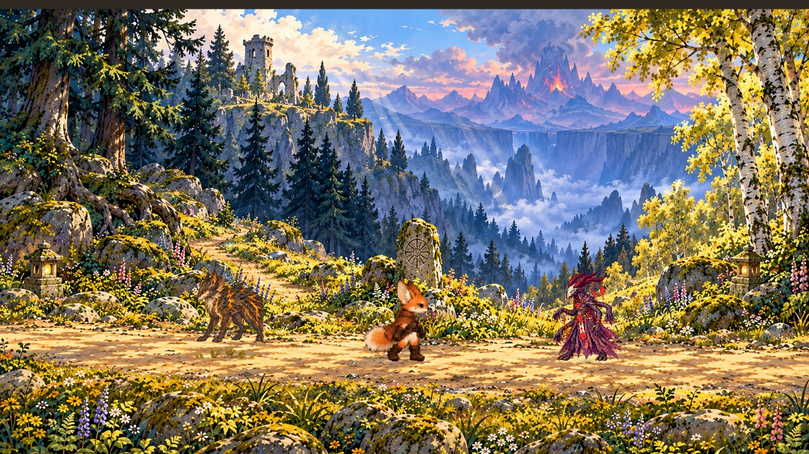
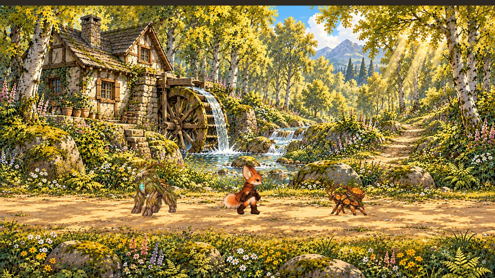
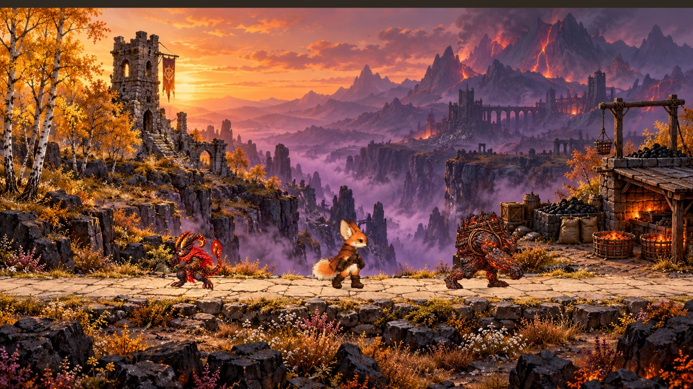

# Getrennte Gegnerreviere und leichteres Laufen an Steigungen

Stand: 17.10.2026, auf dem Quellstand der ausgelieferten AndroidTest-APK 0.9.0
(`da608c141a69d77442a7ef6fe66e36b8aee8dc59`). Dieser Branch ist eine
Quellcode-Erweiterung; er erzeugt oder behauptet keine neue APK-Auslieferung.

## Spielerlebnis

Martin meldet zu viele Gegner auf einem Fleck und mühsame Bewegung an Anhöhen.
Vier regionale Gegner standen in der Nebelwacht, ihre Arbeit bestand überwiegend
in kurzen Links-/Rechtswegen. Sie sind jetzt räumlich aufgeteilt:

| Ort | Gegner |
| --- | --- |
| Sonnenhain | Dornmotte, langer Blütenweg |
| Nebelwacht | Aschenläufer links, Siegelweber rechts |
| Mühlenbach | Rindenwächter links, Harzsammler rechts |
| Aschenstieg | Glutwicht links, Schlackenträger rechts |
| Siegelhof | Vharok am Tor |
| Strand | Tangkrabbler am unveränderten trockenen Küstenabschnitt |

Die normalen Reviere nutzen bis zu drei Wegpunkte mit unterschiedlicher Bildtiefe.
Dornmottes horizontale Strecke wächst von 14 auf 60 Prozent des Sonnenhains;
Rindenwächter und Glutwicht erhalten mehr als die doppelte horizontale Strecke.
Die Zyklen dauern je nach Art 23–32 Sekunden, mit Arbeits- und Ruhephasen.
Vharok behält seinen kleinen Torbereich. Kampfwerte, Beute und Gegner-IDs bleiben
unverändert. Es wurden keine zusätzlichen Landschaftsbilder oder Gebiete angelegt.

Die Wegberechnung verwendet `InteractionPath`, dieselbe trockene Geometrie wie
antippbare Interaktionen. Jeder tatsächlich zurückgelegte Teilweg wird geprüft.
Bei Annäherung auf 1,5 Weltmeter halten Bewegung und Tätigkeitsuhr gemeinsam an;
nach dem Weggehen wird fortgesetzt. Die Nähe verwendet die Bodenposition, sodass
Springen einen wartenden Gegner nicht ständig wieder in Bewegung setzt.

## Hangführung

Die gemalten Anhöhen liegen auf der X/Z-Bühne. Bei überwiegend seitlichem Daumen
prüft `WorldStage.guide_motion` vor der Physikbewegung den nahen Wegrand. Würde
die Eingabe dort gegen eine schräge Begrenzung drücken, führt die lokale
Wegsteigung die Bewegung weiter. Das Tempo bleibt erhalten. Die kurze Vorschau
prüft denselben freien Weg einschließlich Körperradius; Wasser, Abgründe,
Kartenenden und Möbel werden weiterhin gesperrt. Tiefeingaben und Innenräume
behalten ihre direkte Steuerung, Springen und Rollen ihre vertikale Bewegung.

Im identischen Godot-4.5.1-Vergleich mit 60 Physiktakten pro Sekunde erreicht
Fennec den ansteigenden Abschnitt x=13,3→20,5 mit seitlichem Daumen in 160 statt
186 Takten (rund 14 Prozent weniger Zeit); in Gegenrichtung 159 statt 177.
Die Werte sind ein reproduzierbarer Steuerungsvergleich, keine Telefon-FPS-Messung.

## Spielstände

Gegner behalten die Schlüssel `Spezies:Gegner-ID`. Bereits verbuchte Siege und
Beute bleiben erhalten. Bei einem alten laufenden regionalen Kampf wählt der
Spielstart dessen aktuelles Revier und stellt dieselbe gespeicherte Kampfphase
wieder her. Ein normaler gespeicherter Standort wird nicht verlegt. Kein Eingriff
in native Android-Daten, Reminder, Room, LAS oder Signierung.

## Prüfungen und Übergabe

Neue Tests: `tests/enemy_roaming.gd` (Verteilung, vollständige Hin-/Rückwege,
tatsächliche Bewegung, Mindestabstand, Nähepause, alter laufender Kampf und
bestehender Sieg), `tests/roaming_and_slopes.gd` (seitlicher Daumen an vier
Abschnitten in beiden Richtungen sowie alle acht Wesen an der Steigung).
`tests/roaming_capture.gd` erzeugt echte OpenGL-Aufnahmen der drei neu aufgeteilten
Reviere und eines Steigungsabschnitts.

Ältere Gegnerprüfungen sind an die neue Verteilung angepasst. `movement_flow.gd`
verhindert im isolierten Zweifinger-Gestentest einen zufälligen Treffer auf einen
projizierten Ortsmarker und vergleicht die tatsächliche gehaltene Eingabe.
Die Originalatlas-Prüfung läuft nur über die sechs Originalatlanten; die zwei
Kompaktfiguren verwenden eine andere Posenaufteilung und werden im neuen
Steigungstest tatsächlich bewegt. Beide bisherigen Testprobleme waren auch mit
der unveränderten Bewegungsimplementierung reproduzierbar.

Die ausgeführten Ergebnisse stehen unten. Visuelle Abnahme
verwendet Linux/Mesa; echte Android-GPU, FPS und das Daumengefühl am Telefon
bleiben zu prüfen. Vor dem nächsten APK-Auftrag den bestehenden freigegebenen
Manifest-/Versions-/Signierungsweg auf diesen Quellstand anwenden. Für einen
Rückbau genügt ein Revert dieses Branches; die Speicherschlüssel bleiben identisch.

### Ausgeführte Abnahme

- Reviere/Spielstand: 47 Checks, 0 Fehler; Hangsteuerung: 25 Checks, 0 Fehler,
  einschließlich aller acht spielbaren Figuren.
- Bestehende Ökologie/Bossregeln: 1089 Checks, 0 Fehler; Dämonen: 85/0;
  Bewohner/Weltkarte: 692/0; Gesten/Bewegungsablauf: 324/0.
- Umfassende Geh-/Roll-/Sprungränder: 364 Checks, 0 Fehler.
- Türmatrix: 256 Spezies-/Türpfade, 0 Fehler. Katalog- und Originalasset-Prüfung
  bestehen; ursprüngliche Kulissen und Charakterzeichnungen bleiben identisch.
- Vier echte Linux/Mesa-OpenGL-Aufnahmen erzeugt und visuell geprüft.

GitHub-Stand: Der Quellcode-Upload wurde von der automatischen Freigabeprüfung
wegen fehlender ausdrücklicher Zustimmung blockiert. Der geprüfte Branch ist
lokal committet; eine erneute Übertragung wartet auf Martins Zustimmung.
