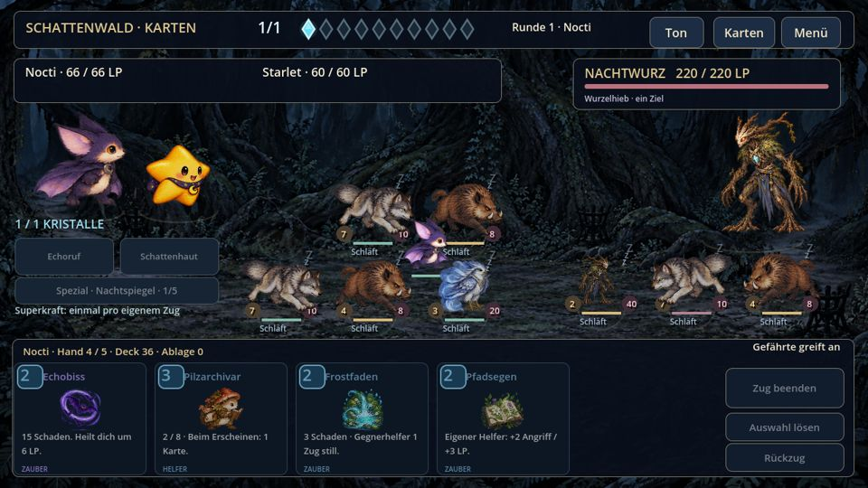
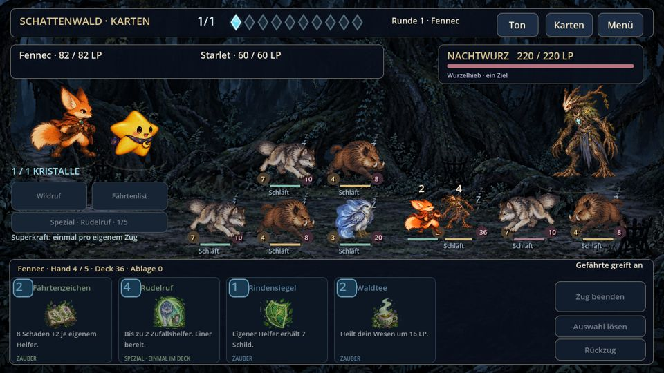
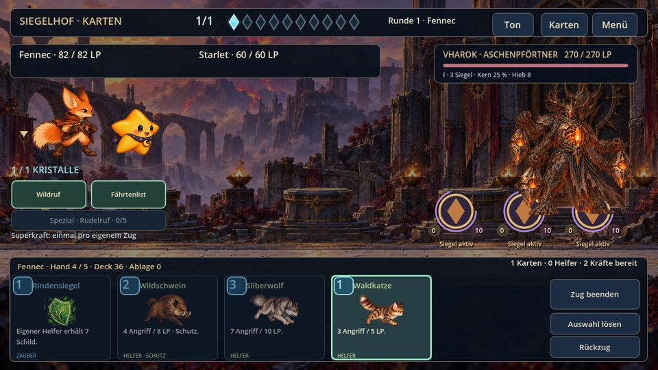

# Kampfbewegung, Standplätze und Figurenlicht – AndroidTest 0.10.0

Martins Auftrag vom 17.10.2026: Nach den freigegebenen Gegner-/Hangkorrekturen
steife, unlogisch laufende Kampffiguren sowie Beleuchtung und Schatten verbessern;
anschließend eine neue APK erstellen. Grundlage ist PR368 mit dem vollständigen
Quellbaum `6aa30552e678c6dcaae362d43ca1d1e3457fea3d`.

## Sichtbare Änderungen

- Helfer behalten ihre Plätze, wenn ein Nachbar fällt. Es gibt keine sofortige
  Verschiebung der ganzen Formation. Die sichtbaren Standflächen kennzeichnen die
  Bereiche unter den Hauptfiguren und Helfern zurückhaltend.
- Ein Angriff hat Vorbereitung, gekrümmten Hinweg, Kontakt und Rückweg. Gegnerische
  Helfer verwenden getrennte Bahnen und Kontaktpunkte. Die Bodenprojektion bleibt
  innerhalb der Kampfbühne; Figuren rutschen nicht über den Bildschirmrand.
- Während eines Wegs werden vorhandene Laufzeichnungen benutzt, wenn der Helfer
  eine der acht spielbaren Spezies ist. Andere Helfer verwenden ihre vorhandenen
  Bewegungs-/Flugzeichnungen. Blickrichtung und Laufphase folgen dem Weg;
  Angriffsposen erscheinen am Kontakt, nicht während des gesamten Hinwegs.
- Hauptfiguren verwenden begrenzte Vorbereitungsschritte, kurze Trefferreaktionen
  und sehr kleine ruhige Gewichtsverlagerungen. Beschwören lässt sie nicht quer
  durch die Formation laufen.
- Ein gefallener Helfer zeigt den kurzen Fallablauf an seinem bisherigen Ort.
  Ein im Gegentreffer gefallener Angreifer fällt am Kontaktpunkt und läuft nicht
  zurück. Bild, Schatten, Trefferzahlen und Licht verwenden denselben Ort.
- Mehrere weiche Schattenlagen ersetzen die harten schwarzen Ellipsen. Schatten
  bleiben am Boden, während fliegende/springende Figuren angehoben sind; bei einer
  Fallblende verschwindet auch der Schatten.
- Einzelne gemalte Figuren erhalten ein eigenes Canvas-Material mit mildem
  Umgebungs-/Seitenlicht und einer schmalen, innerhalb ihrer Alphakontur bleibenden
  Lichtkante. Warme Dämonenorte und kühler Wald unterscheiden sich. Kurzes
  Trefferlicht bleibt auf tatsächliche Treffer-/Schutz-/Gegentrefferorte begrenzt.
  Karten, Text und Bedienfelder werden nicht mit diesem Figurenlicht eingefärbt.

Die vorhandenen Gemälde und Charakterzeichnungen bleiben erhalten. Es wurden
keine neuen Kreaturengrafiken generiert und keine Kampfwerte oder Beute geändert.
Ein einzelner Helferangriff nutzt jetzt 2,7 Sekunden mit Kontakt bei 1,25 Sekunden,
damit Hin- und Rückweg lesbar bleiben. Gespeicherte Ereignisse behalten ihre
bisherige Zeit; neue Ereignisse speichern die angepasste Zeit wie zuvor im
bestehenden Ereignisformat. Schaden und Beute werden weiterhin einmal im Modell
aufgelöst. Keine neue Spielstand-Schema-Version.

## Umsetzung

`battle_motion.gd` liefert deterministische Darstellungsdaten. `battle_pawn.gd`
und `battle_portrait.gdshader` zeichnen die Körper getrennt von der Bedienung.
Ein Pool aus 16 Elementen deckt drei Hauptfiguren, neun Helfer und Übergangsreserve
ab. Bewegte Schatten, Lebensbalken und die vorhandenen Bereitschaftsanzeigen
folgen dem jeweiligen Körper bzw. Bodenkontakt. `card_view.gd` hält die
Formationsplätze während eines Ereignisses fest und zeigt gefallene Figuren nur
für den begrenzten Ablauf.

## Prüfung

- `combat_motion_light.gd`: 115 Checks ohne Fehler: Hin-/Rückwege, Bodenbegrenzung,
  getrennte Kontaktpunkte, echte Kartenangriffe, feste Plätze nach Tod,
  Fallposition, örtliches Trefferlicht, unveränderter gespeicherter Kampf.
- Acht vollständige Kartenkämpfe gewonnen. Bestehende Karten-UI69, Minion-Touch24,
  Klang/Lesbarkeit29, Darstellung36, Karten-Erweiterung441, Siegesablauf96 und
  Ökologie/Boss1089 Checks jeweils ohne Fehler.
- 66 echte Linux/Mesa-OpenGL-Aufnahmen: Formation und sieben Zeitpunkte mit jeder
  der acht Spezies, außerdem Vharok. Die Abnahme prüft Anlauf, Kontakt, Rückweg,
  Alphakonturen, Licht und sichtbare Kopf-/Fußbereiche.
- Der historische `turn_battle.gd` meldet einen Mooslyn-Fähigkeits-Befund auch im
  unveränderten Ausgangsstand (189 Checks, ein Fehler). Das ist getrennt von den
  erfolgreichen aktiven Kartenkampfprüfungen; diese Änderung repariert oder
  versteckt den älteren Modellbefund nicht.

Die vollständigen erneuten Bauprüfungen und das Lieferergebnis stehen im PR bzw.
im GitHub-Baulauf. Android-GPU/FPS und menschliches Daumengefühl bleiben ohne
Telefonprüfung offen. Die 115 Checks oder die Desktop-Aufnahmen ersetzen diese
Abnahme nicht.

## APK-Auftrag

AndroidTest0.10.0 / Code22, bestehende Paketkennung
`com.itoeva.godot.hd2d.worldtest`. Das neue Manifest umfasst327 Laufzeit-/Exportdateien.
Der vorhandene Workflow prüft dieses Manifest, die Regressionen und GL-Aufnahmen,
exportiert ARM64 und prüft zusätzlich den bereits verwendeten Zertifikatabdruck.
Keystore, SDK-Bezug und Drive-Lieferkonto werden nicht geändert. Die vorhandene
freigegebene Drive-Zieldatei bleibt im selben Ordner und erhält den neuen Namen.
Ein erfolgreicher Build und Remote-Prüfsummenabgleich sind für die Auslieferung
maßgeblich; dieses Dokument allein behauptet keinen abgeschlossenen Export.

